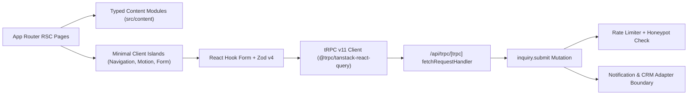

# BLACKSTEEL Construction & Remodeling — Architecture & Design Plan

## 1. Repository Audit & Verified Stack

### Current Workspace State

- Directory `/Users/jojovera/Dev/blacksteel` is a greenfield project (not yet initialized with git or `package.json`).
- Approved brand logo assets are already present at the workspace root and will be relocated to `public/brand/` during Phase 2 without alteration:
  - `logo-black.png` (2104 x 747 RGBA PNG, dark wordmark and architectural house silhouette for light `#F2F0EC` surfaces)
  - `logo-white.png` (2104 x 747 RGBA PNG, inverted white wordmark and architectural house silhouette for dark `#17191B` / `#34383C` surfaces)
- Runtime verified: Node `v22.15.1`, npm `10.9.2`.

### Verified Dependency Matrix (Compatible Latest Releases)

- Framework: `next@16.4.6`, `react@19.3.1`, `react-dom@19.3.1` (App Router, React Server Components by default)
- Language: `typescript` (`>=5.7.2`, strict mode enabled)
- Styling: `tailwindcss@4.3.5`, `@tailwindcss/postcss`, `clsx`, `tailwind-merge` (CSS-first `@theme inline` configuration)
- API & Validation: `@trpc/server@11.29.7`, `@trpc/client@11.29.7`, `@trpc/tanstack-react-query@11.29.7`, `@tanstack/react-query@5.108.2`, `zod@4.6.7`, `client-only`, `server-only`
- Forms: `react-hook-form@7.92.0`, `@hookform/resolvers@7.0.8` (supports Zod v4 via Standard Schema)
- Motion & Icons: `motion@14.14.0` (imported from `motion/react`), `lucide-react@1.77.0`
- Aceternity UI: Installed selectively via `shadcn` registry (`"@aceternity": "https://ui.aceternity.com/registry/{name}.json"`), verified compatible with Next.js 16, React 19, Tailwind CSS v4, and `motion/react`.

---

## 2. Design Reference Critique & Creative Direction

### Insights Drawn from Reference (`eliterestorations.com`)

- Strengths to respect: calm, unhurried editorial tone, clear regional Texas grounding, structured multi-step process clarity, and authentic craftsmanship positioning without hyperbole.
- Divergences required for BLACKSTEEL: the reference foregrounds emergency water/storm restoration, insurance claims, review carousels, and dense local-service keyword lists. BLACKSTEEL must pivot decisively toward an **architectural monograph and bespoke studio** identity where luxury remodeling and architectural customization lead, and restoration sits cleanly as a specialized capability rather than the dominant narrative.

### BLACKSTEEL Creative Concept: "Architectural Monograph"

- **Atmosphere**: Entering a private Houston/Austin architecture and build studio at dusk — monolithic dark surfaces, razor-thin stone-gray drafting rules, large-format interior photography, and deliberate shifts into warm Soft Ivory paper interludes.
- **Visual Rules**:
  - Zero generic 3-column contractor service cards, zero floating SaaS badges, zero star-rating widgets, and zero gold/bronze/copper/metallic gradients.
  - Sharp architectural geometry (`0px` to `2px` border radius on frames and buttons) instead of soft rounded SaaS pills.
  - Asymmetric 12-column editorial grids with generous negative space and strict typographic hierarchy.
  - Surface polarity rhythm: alternating dark monolithic sections (`#17191B` / `#34383C`) with quiet Soft Ivory (`#F2F0EC`) editorial chapters.

---

## 3. Design System, Dark/Light Themes & Glass Surfaces

### Tailwind CSS v4 Dual-Theme Paradigm (Dark Default + Light Mode)

- Configure class-driven dark mode in `src/app/globals.css` using Tailwind CSS v4's native `@custom-variant dark (&:where(.dark, .dark *));` directive.
- Default `<html lang="en" className="dark" suppressHydrationWarning>` on initial render, paired with a tiny inline pre-hydration script in `src/app/layout.tsx` that reads `localStorage("blacksteel-theme")` (`"dark"` fallback by default, never flashing light on first paint).
- A minimal `ThemeProvider` and accessible `ThemeToggle` control in `SiteHeader` / `MobileMenu` switches `.dark` on `<html>`, allowing visitors to experience both the flagship dark architectural mode and the sunlit Soft Ivory architectural mode seamlessly using standard Tailwind `dark:` variants and semantic CSS custom properties.

### Official Color Tokens & Semantic Surface Mapping (`@theme inline`)

- **Base Palette (Immutable)**:
  - `--color-obsidian: #17191B` (Primary Black)
  - `--color-graphite: #34383C` (Graphite)
  - `--color-stone: #A7A6A3` (Stone Gray)
  - `--color-ivory: #F2F0EC` (Soft Ivory)
- **Harmonized Neutrals (Contrast-Verified)**:
  - `--color-ivory-muted: #D8D5CF` (secondary copy on dark surfaces)
  - `--color-ivory-elevated: #E8E5DF` (subtle tonal step on light surfaces)
  - `--color-stone-deep: #5C5B58` (muted metadata/eyebrows on light `#F2F0EC` surfaces for WCAG AA contrast)
  - `--color-error: #B85C5C` (muted architectural terracotta-red for accessible validation)
- **Semantic Theme Variables (`:root` light vs `.dark` dark)**:
  - `--surface-canvas`: `#F2F0EC` (light) / `#17191B` (dark)
  - `--surface-elevated`: `#E8E5DF` (light) / `#34383C` (dark)
  - `--surface-contrast`: `#17191B` (light interlude) / `#F2F0EC` (dark interlude — preserves the alternating editorial rhythm in both themes)
  - `--ink-primary`: `#17191B` (light) / `#F2F0EC` (dark)
  - `--ink-secondary`: `#34383C` (light) / `#D8D5CF` (dark)
  - `--ink-muted`: `#5C5B58` (light) / `#A7A6A3` (dark)
  - `--border-hairline`: `rgba(23, 25, 27, 0.14)` (light) / `rgba(167, 166, 163, 0.22)` (dark)

### Architectural Glass & Blur System (`@utility` classes in `globals.css`)

- Glass effects evoke smoked architectural glazing and frosted mineral glass — zero neon borders, zero rainbow/SaaS gradients, and strict contrast discipline:
  - **Obsidian Smoked Glass** (dark surfaces & dark image overlays): `bg-[#17191B]/68 backdrop-blur-xl backdrop-saturate-150 border border-[#A7A6A3]/22 shadow-[inset_0_1px_0_0_rgba(242,240,236,0.08)]`
  - **Ivory Frosted Glass** (light surfaces): `bg-[#F2F0EC]/74 backdrop-blur-xl backdrop-saturate-150 border border-[#17191B]/12 shadow-[inset_0_1px_0_0_rgba(255,255,255,0.45)]`
  - **Tactile Photo Glass** (floating captions, CTAs, and spec overlays over photography): `bg-[#17191B]/55 backdrop-blur-md border border-[#F2F0EC]/18 text-[#F2F0EC]`
- **Intentional Placement & Performance Guardrails**:
  - Applied to sticky navigation (`SiteHeader`), full-screen mobile drawer (`MobileMenu`), hero glass secondary CTA & floating architectural metadata strip, active image spec overlays in Expertise/Approach, portfolio corner index badges, and elevated inquiry panels.
  - Intentionally omitted on rapidly scrolling parallax cards and large body-copy containers to maintain 60fps mobile scrolling and crisp text legibility.
  - Paired with `@supports not (backdrop-filter: blur(1px))` higher-opacity solid fallbacks (`#17191B/92` or `#F2F0EC/95`).

### Typography Pairing (`next/font/google`)

- **Display Serif**: `Cormorant Garamond` (weights 400, 500, 600, italic 400) — harmonizes directly with the classic serif letterforms of the approved `BLACKSTEEL` wordmark. Used for `h1`–`h3`, pull quotes, and oversized section numerals (`01`–`08`).
- **Supporting Sans**: `Manrope` (weights 300, 400, 500, 600) — clean geometric humanity with crisp tabular numerals (`tabular-nums`) for architectural indices, dimensions, and form controls.
- **Type Scale & Rhythm**:
  - Hero Display: `clamp(3rem, 6.2vw, 6rem)`, line-height `0.98`, tracking `-0.025em`
  - Editorial Statement: `clamp(2.25rem, 4.2vw, 4.25rem)`, line-height `1.04`, tracking `-0.02em`
  - Section Title: `clamp(1.75rem, 3vw, 2.75rem)`, line-height `1.1`
  - Eyebrow / Architectural Index: `11px`–`12px` Manrope uppercase, tracking `0.18em`, semantic `--ink-muted`
  - Body Copy: `16px`–`18px` Manrope, line-height `1.65`, measure capped at `62ch`, sentence case (no excessive ALL CAPS in body text).

### Dual-Logo Integration

- `BrandLogo` component in [src/components/ui/BrandLogo.tsx](src/components/ui/BrandLogo.tsx) renders `next/image` with exact `2104 / 747` intrinsic ratio (`priority` in header).
- Supports `surface?: "auto" | "dark" | "light"`:
  - `"auto"` uses pure Tailwind CSS dark-mode switching (`dark:block hidden` for `/brand/logo-white.png` and `dark:hidden block` for `/brand/logo-black.png`) for zero hydration mismatch or theme-switch flicker.
  - `"dark"` / `"light"` locks a specific variant when placed over an always-dark cinematic hero/footer or an inverted contrast interlude.

---

## 4. Technical Architecture & Folder Structure

```text
blacksteel/
├── public/
│   ├── brand/
│   │   ├── logo-black.png
│   │   └── logo-white.png
│   └── images/
│       └── demo/                # Clearly attributed local demonstration photography
├── src/
│   ├── app/
│   │   ├── layout.tsx           # Root RSC layout, fonts, Metadata base, TRPCReactProvider
│   │   ├── globals.css          # Tailwind v4 @import + @theme inline tokens + reduced-motion rules
│   │   ├── page.tsx             # Homepage (RSC)
│   │   ├── not-found.tsx        # Architectural 404
│   │   ├── error.tsx            # Client error boundary
│   │   ├── loading.tsx          # Minimal transition state
│   │   ├── sitemap.ts           # Dynamic XML sitemap
│   │   ├── robots.ts            # Robots configuration
│   │   ├── about/page.tsx
│   │   ├── services/
│   │   │   ├── page.tsx
│   │   │   ├── luxury-remodeling/page.tsx
│   │   │   ├── kitchen-remodeling/page.tsx
│   │   │   ├── bathroom-remodeling/page.tsx
│   │   │   ├── custom-construction/page.tsx
│   │   │   ├── general-contracting/page.tsx
│   │   │   └── restoration/page.tsx
│   │   ├── projects/
│   │   │   ├── page.tsx
│   │   │   └── [slug]/page.tsx
│   │   ├── process/page.tsx
│   │   ├── locations/
│   │   │   ├── houston/page.tsx
│   │   │   └── austin/page.tsx
│   │   ├── contact/page.tsx
│   │   ├── privacy/page.tsx
│   │   └── api/trpc/[trpc]/route.ts
│   ├── components/
│   │   ├── layout/              # SiteHeader, MobileMenu, SiteFooter, ThemeProvider, ThemeToggle, Container, SectionShell
│   │   ├── motion/              # MotionProvider (MotionConfig reducedMotion="user"), RevealMask, ArchitecturalRule, ParallaxFrame
│   │   ├── ui/                  # BrandLogo, EditorialHeading, ActionLink, GlassPanel, DemoBadge
│   │   ├── aceternity/          # Adapted Compare & StickyScrollReveal (re-themed to BLACKSTEEL)
│   │   ├── sections/home/       # 8 dedicated homepage section modules (01–08)
│   │   └── forms/               # ProjectInquiryForm (React Hook Form + Zod + tRPC)
│   ├── features/
│   │   ├── portfolio/           # Typed repository interface + demo project queries
│   │   ├── services/            # Service taxonomy, detail helpers
│   │   └── contact/             # Inquiry validation schema (shared client/server)
│   ├── content/
│   │   ├── media.ts             # Centralized media registry with demo flags & attribution
│   │   ├── projects.ts          # Typed demonstration portfolio dataset
│   │   ├── services.ts          # Typed core & sub-service content
│   │   ├── locations.ts         # Houston & Austin architectural/market content
│   │   └── site.ts              # Navigation, brand voice copy, owner-confirmation markers
│   ├── server/
│   │   ├── api/
│   │   │   ├── trpc.ts          # initTRPC, context, baseProcedure
│   │   │   ├── root.ts          # appRouter + AppRouter type
│   │   │   └── routers/
│   │   │       └── inquiry.ts   # Project inquiry mutation + rate-limit/provider boundaries
│   │   ├── integrations/        # Abstracted InquiryPersistence & Notification adapters (stubbed safely)
│   │   └── trpc/
│   │       ├── server.ts        # RSC caller / createTRPCOptionsProxy
│   │       ├── client.tsx       # TRPCReactProvider + useTRPC
│   │       └── query-client.ts  # makeQueryClient factory
│   ├── lib/
│   │   ├── utils.ts             # cn() utility
│   │   ├── seo.ts               # Metadata & JSON-LD builders
│   │   └── rate-limit.ts        # Memory/sliding-window rate limiter interface (swappable for Upstash/Redis)
│   └── types/
│       └── domain.ts            # Project, Service, Location, Inquiry types
```

### Architecture & Rendering Diagram



---

## 5. Homepage Section-by-Section Specification (01–08)

The homepage supports both dark (default) and light Tailwind modes while preserving strong architectural contrast between primary canvas sections and inverted editorial interludes:

- **Header (`SiteHeader`)**: Transparent fixed overlay at `y = 0` over the hero (`logo-white.png`), minimal 5-link navigation (`Work`, `Expertise`, `Approach`, `About`, plus restrained `Start a Project` CTA) and a minimal `ThemeToggle` button (`Dark / Light`). On scroll past hero threshold (`> 80px`), smoothly transitions into an architectural glass bar (`glass-obsidian` in dark mode with `logo-white.png`; `glass-ivory` in light mode with `logo-black.png`) using Tailwind `dark:` variants and `backdrop-blur-xl`. Accessible full-screen frosted glass `MobileMenu` (`backdrop-blur-2xl`) with `Escape` close, focus trap, theme toggle, and `aria-expanded`.
- **Section 01 — Cinematic Hero (`Always Dark` Photographic Canvas `#17191B`)**:
  - Full-viewport (`min-h-[100svh]`) edge-to-edge architectural interior photograph (custom dark walnut & honed stone kitchen/living space) with subtle directional dark vignette (`from-[#17191B]/80 via-[#17191B]/35 to-[#17191B]/90`) for guaranteed WCAG AA contrast in both themes.
  - Bottom-anchored asymmetric composition: `01 / HOUSTON & AUSTIN, TEXAS` eyebrow, oversized Cormorant Garamond H1 `"Built Beyond Ordinary."`, concise 2-line architectural positioning statement, primary solid Soft Ivory CTA (`"Start Your Project"` -> `/contact`), secondary frosted-glass CTA (`"Explore Our Work"` -> `/projects` with `backdrop-blur-md bg-[#17191B]/45 border-[#F2F0EC]/30`), and a floating smoked-glass studio coordinate/scroll dock at the bottom right.
  - Motion: subtle initial image scale settle (`1.06 -> 1.0` over `1.1s` ease-out), staggered masked line reveal for H1 and CTAs. Zero scroll-blocking preloader.
- **Section 02 — Brand Introduction (Contrast Interlude: `#F2F0EC` in Dark Mode / `#17191B` in Light Mode)**:
  - Deliberate theme-polarity inversion creates crisp editorial rhythm immediately following the hero.
  - 12-column asymmetrical split: Left 7 columns carry `02 / THE STUDIO` eyebrow + oversized editorial thesis highlighting a sibling-led, family-owned construction practice dedicated to architectural clarity, complex residential remodeling, and disciplined execution across Houston and Austin (zero invented founding years or credentials). Right 5 columns pair a tall portrait architectural detail photo (with an understated glass caption plaque at its lower edge) with measured body copy and a quiet `"Our Philosophy"` link to `/about`.
  - Motion: architectural hairline divider (`scaleX: 0 -> 1` on viewport entry) and gentle clip-path image wipe.
- **Section 03 — Selected Work (Primary Canvas: `#17191B` Dark / `#F2F0EC` Light)**:
  - Signature asymmetric 2-column staggered gallery (1 full-span lead study + 2 offset vertical/landscape studies) showcasing clearly badged `DEMONSTRATION PROJECT` studies (e.g., _Memorial Residence — Whole-Home & Millwork_, _Westlake Pavilion — Kitchen & Structural Addition_, _River Oaks Bath Sanctuary — Stone & Custom Cabinetry_).
  - Each card features subtle frosted-glass `DEMONSTRATION` / index corner plaques (`backdrop-blur-md`), category, city/state, and title — zero drop shadows or SaaS pill tags. Hover triggers a restrained `1.03` inner-frame image zoom and hairline arrow translation. Clicking routes cleanly to `/projects/[slug]`.
- **Section 04 — Expertise (Elevated Surface: `#34383C` Dark / `#E8E5DF` Light)**:
  - Interactive **Architectural Panel Accordion / Split Showcase** (desktop: left interactive list of 4 pillars with live-swapping high-res editorial image frame on the right featuring a frosted-glass scope summary drawer at its base; mobile: clean expandable accordion with inline photography).
  - Pillars in priority order: `01 Luxury Remodeling`, `02 Custom Construction`, `03 General Contracting`, `04 Restoration & Reconstruction` (positioned thoughtfully as structural & architectural recovery rather than emergency franchise triage). Each links to its dedicated `/services/*` route.
- **Section 05 — The Details Matter (Contrast Interlude: `#F2F0EC` Dark / `#17191B` Light)**:
  - Editorial design-journal spread celebrating tactile execution: _Custom Millwork_, _Natural Stone & Surfaces_, _Architectural Joinery_, and _Site Coordination_.
  - Asymmetric 3-frame photographic triptych paired with an integrated customized Aceternity `Compare` preview showing raw framing-to-finished-millwork precision, with frosted glass `"Before / After"` labels and tight architectural captions.
- **Section 06 — Our Approach (Primary Canvas: `#17191B` Dark / `#F2F0EC` Light)**:
  - Customized Aceternity `Sticky Scroll Reveal` re-engineered into an architectural 5-stage sequence: `01 Discover`, `02 Define`, `03 Design & Plan`, `04 Execute`, `05 Refine & Deliver`.
  - Left rail: numbered stages with crisp hairlines that illuminate on active step. Right rail: sticky editorial frame showing corresponding architectural photography and a floating glass deliverable summary bar (`bg-[#17191B]/65 backdrop-blur-xl`). Falls back gracefully to a stacked timeline on mobile.
- **Section 07 — Houston & Austin (Elevated Surface: `#34383C` Dark / `#E8E5DF` Light)**:
  - Editorial diptych contrasting Houston's established estates/high-humidity structural engineering realities with Austin's hillside topography, limestone terrain, and indoor-outdoor architectural sensibilities.
  - Two large interactive regional panels with subtle frosted-glass bottom metadata bands linking to `/locations/houston` and `/locations/austin`. Zero fabricated street addresses or office suites.
- **Section 08 — Final Conversion (`#17191B` Dark / `#F2F0EC` Light) & `SiteFooter`**:
  - Full-bleed architectural closing statement backed by a subtle atmospheric architectural photograph and a centered frosted-glass conversion frame (`glass-obsidian` / `glass-ivory`): `"Let's Build Something Exceptional."` with concise consultation invitation, primary CTA to `/contact`, and an inline streamlined quick-inquiry drawer/link option.
  - Minimal 3-column architectural `SiteFooter` (always grounded in dark `#17191B` or theme-responsive with matching `BrandLogo`): regional coverage (`Houston & Austin, Texas`), navigation columns, `[OWNER CONFIRMATION REQUIRED]` contact slots, theme switch, copyright, and `/privacy` link.

---

## 6. Aceternity UI Selection & Adaptation Strategy

To preserve originality and performance, we will install and heavily customize only **3 targeted Aceternity UI components** (no default demos, no neon glows, no sparkles):

1. **`Sticky Scroll Reveal`** (`@aceternity/sticky-scroll-reveal`) -> `src/components/aceternity/ArchitecturalStickyReveal.tsx`
   - Used in Homepage Section 06 ("Our Approach") and `/process`.
   - Customization: Remove default multi-color background gradients and rounded-md SaaS cards; replace with `#17191B` ground, `#A7A6A3/20` horizontal drafting rules, Cormorant Garamond step numbers (`01`–`05`), and crisp `next/image` media frames.
2. **`Compare`** (`@aceternity/compare`) -> `src/components/aceternity/ArchitecturalCompare.tsx`
   - Used on `/projects/[slug]` (optional before-and-after structural transformation) and Section 05 / `/services/restoration`.
   - Customization: Strip `@aceternity/sparkles` dependency and cyan/indigo glow gradients completely; build a restrained `1px` `#F2F0EC` hairline slider with a minimal `#17191B` / `#F2F0EC` tactile drag handle and `aria-label` keyboard support.
3. **`Parallax Scroll`** (`@aceternity/parallax-scroll`) -> `src/components/aceternity/EditorialParallaxGrid.tsx`
   - Used on `/projects` portfolio index or `/about` craftsmanship gallery (desktop only, disabled cleanly under `prefers-reduced-motion` and stacked cleanly on mobile).
   - Customization: Replace rounded-lg thumbnails with sharp `0px` architectural frames, muted `#A7A6A3` image index captions, and constrained vertical travel (`±36px`) to avoid disorientation.

**Explicitly Rejected**: `Background Beams`, `3D Card Effect`, `Sparkles`, `Hero Highlight`, `Glowing Stars` — all clash with BLACKSTEEL's understated, non-metallic architectural restraint and add unnecessary client bundle/GPU cost.

---

## 7. Full Route Structure, Portfolio Model & SEO

### Route Inventory

- `/` — Homepage (evaluated visually before expanding internal pages)
- `/about` — Sibling-owned studio narrative, values, leadership placeholders
- `/services` — Services overview
- `/services/luxury-remodeling` — Whole-home & architectural interior remodeling
- `/services/kitchen-remodeling` — Bespoke cabinetry, stone, appliance integration
- `/services/bathroom-remodeling` — Spa-grade stone, wet rooms, custom vanities
- `/services/custom-construction` — Structural additions, pavilions, custom builds
- `/services/general-contracting` — Trade orchestration, budget/schedule governance
- `/services/restoration` — Architectural property restoration & reconstruction
- `/projects` — Portfolio index with client-side/URL-synced category & city filters
- `/projects/[slug]` — Project detail template (narrative, scope, materials palette, gallery, optional `ArchitecturalCompare` before/after)
- `/process` — Detailed 5-phase methodology
- `/locations/houston` & `/locations/austin` — Substantive regional architectural guidance
- `/contact` — Full Project Inquiry experience
- `/privacy`, `/not-found`, `/error`, `/loading`

### Typed Portfolio & Content Abstraction (`src/types/domain.ts` & `src/features/portfolio/`)

- `Project` interface: `slug`, `name`, `category`, `city`, `state`, `shortDescription`, `fullNarrative`, `coverImage`, `galleryImages`, `scopeOfWork`, `materialsAndFinishes`, `featured`, `isDemonstration`, `beforeAfterImages?`, `completionDate?`.
- `PortfolioRepository` interface (`getAllProjects`, `getFeaturedProjects`, `getProjectBySlug`, `getProjectsByCategory`) backed initially by typed `src/content/projects.ts` — swappable for Sanity/Payload/Postgres with zero UI changes.

### SEO & Structured Data (`src/lib/seo.ts`)

- Page-specific `generateMetadata` with canonical URLs, Open Graph, and Twitter/X cards.
- Dynamic `sitemap.ts` (including all static routes + project slugs) and `robots.ts`.
- Conservative JSON-LD (`HomeAndConstructionBusiness` with `areaServed: ["Houston, TX", "Austin, TX"]`) strictly omitting unverified street addresses, ratings, or license numbers.

---

## 8. tRPC v11 + Zod v4 Inquiry Architecture

- **Shared Validation (`src/features/contact/schema.ts`)**:
  - Required: `fullName`, `email`, `projectLocation` (`"Houston"` | `"Austin"` | `"Other Texas"`), `projectType` (enum aligned to services), `projectDescription` (min 20 chars).
  - Genuinely optional: `phone` (validated if provided), `budgetRange`, `timeline`.
  - Spam guard: hidden `companyWebsite` honeypot field (rejected silently/cleanly on server if populated).
- **tRPC Infrastructure**:
  - `src/server/api/trpc.ts`: context receives request headers (IP extraction for rate limiting, never logged alongside PII).
  - `src/server/api/routers/inquiry.ts`: `inquiry.submit` mutation checks rate limit (`5 requests / 15 min / IP` via `src/lib/rate-limit.ts`), validates with Zod v4, invokes `InquiryGateway` adapter (`src/server/integrations/inquiry-gateway.ts`), and returns `{ status: "received_demo", referenceId, deliveryConfigured: false }` — explicitly honest that email/CRM delivery awaits provider keys (Resend/Postmark + CRM webhook) rather than faking persistence.
  - `src/app/api/trpc/[trpc]/route.ts`: App Router `fetchRequestHandler` supporting `GET` and `POST`.

---

## 9. Missing Assets & Business Inputs (Marked for Owner Confirmation)

Every scaffolded placeholder will carry an explicit `[DEMO]` or `[OWNER CONFIRMATION REQUIRED]` annotation in code and UI where appropriate:

1. **Project Photography & Case Studies**: Real before/after and completed project photography (high-res landscape + portrait) for Houston and Austin residences. Initial build will use locally stored, royalty-free Unsplash architectural demonstration images documented in `src/content/media.ts`.
2. **Contact Endpoints & Office Details**: Official BLACKSTEEL phone number, inquiry email address, physical mailing/studio address (or service-area-only preference), and email provider API key (e.g., Resend) + CRM target.
3. **Sibling Founders & Bio Details**: Names, roles, and verified company background/credentials for `/about` and `HomeAndConstructionBusiness` structured data.
4. **Legal & Compliance**: Approved Privacy Policy text and Texas contractor/warranty disclosures for `/privacy`.

---

## 10. Phased Implementation Roadmap & Acceptance Gates

### Phase 2 — Foundation

- Scaffold Next.js 16 + TypeScript strict + Tailwind CSS v4 project around existing `logo-black.png` and `logo-white.png` (moved to `public/brand/`).
- Install verified dependencies (`@trpc/*`, `@tanstack/react-query`, `zod`, `react-hook-form`, `@hookform/resolvers`, `motion`, `lucide-react`, `clsx`, `tailwind-merge`) and initialize Aceternity registry in `components.json`.
- Configure `globals.css` with `@custom-variant dark (&:where(.dark, .dark *));`, semantic theme tokens (dark default `#17191B` + light `#F2F0EC`), and architectural glass `@utility` classes (`glass-obsidian`, `glass-ivory`, `glass-photo`) with solid fallbacks.
- Configure Cormorant Garamond + Manrope fonts, pre-hydration dark-default theme script + `ThemeProvider`/`ThemeToggle`, `MotionProvider` (`reducedMotion="user"`), `SiteHeader`, `SiteFooter`, and tRPC v11 route/provider setup.
- **Gate**: `tsc --noEmit` passes, root layout renders clean shell with zero-flicker `BrandLogo` and working dark/light toggle.

### Phase 3 — Homepage & Mandatory Visual Evaluation Gate

- Source/prepare high-resolution demonstration architectural photography locally in `public/images/demo/` with full source/license attribution in `src/content/media.ts`.
- Build all 8 homepage sections (`01` Hero through `08` Final Conversion) with full dark/light Tailwind parity, intentional frosted-glass overlays/docks, adapted `ArchitecturalStickyReveal` & `ArchitecturalCompare`, and frosted-glass mobile drawer.
- **Mandatory Evaluation Gate**: Start dev server, inspect the rendered homepage in **both dark (default) and light modes** inside `cursor-ide-browser` across desktop (`1440px`), tablet (`768px`), and mobile (`390px`), verify contrast over glass/blurred layers, typography, dual-logo legibility, animation smoothness, and zero layout shift (`CLS`), and refine any visual flaws **before** scaffolding internal pages.

### Phase 4 — Internal Pages & Full Inquiry Flow

- Scaffold `/about`, `/services` + 6 sub-service routes, `/projects` + `/projects/[slug]` (including `ArchitecturalCompare` demo), `/process`, `/locations/houston`, `/locations/austin`, `/contact` (full React Hook Form + Zod + tRPC `inquiry.submit` with frosted glass inquiry panel), `/privacy`, `not-found.tsx`, `error.tsx`, `loading.tsx`, `sitemap.ts`, and `robots.ts`.

### Phase 5 — Quality Assurance & Verification

- Run `npm run typecheck`, `npm run lint`, and `npm run build` cleanly.
- Verify keyboard navigation, focus rings, dark/light theme persistence, glass fallback contrast, `prefers-reduced-motion`, SEO metadata/JSON-LD, and end-to-end tRPC inquiry validation in the browser.
