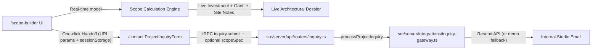

# Interactive Scope, Timeline & Investment Modeler (`/scope-builder`)

## Architecture & Data Flow

The modeler runs as a deterministic, client-side calculation engine backed by shared Zod schemas so the exact structured specification flows cleanly from `/scope-builder` to `/contact`, through `trpc.inquiry.submit`, and into an internal email notification (while preserving `InquiryDeliveryAdapter` for a future Jobber integration).

## 1. Domain Schema & Deterministic Modeling Engine

Create a dedicated feature module under `src/features/scope-builder/`:

- **[src/features/scope-builder/schema.ts](src/features/scope-builder/schema.ts)**:
  - Define Zod schemas and TypeScript types reusing `PROJECT_LOCATIONS` (`Houston` | `Austin`) and the 4 core residential `PROJECT_TYPES` from [src/features/contact/schema.ts](src/features/contact/schema.ts):
    - `Luxury Kitchen Renovation`
    - `Custom Bathroom Renovation`
    - `Whole-Home Remodeling`
    - `Structural Renovation / Addition`
  - Define input dimensions:
    - `market`: `"Houston" | "Austin"`
    - `discipline`: one of the 4 core residential types
    - `squareFeet`: bounded number with discipline-calibrated defaults/ranges (e.g., Bath `80–450 sf`, Kitchen `180–900 sf`, Addition `400–2,500 sf`, Whole-Home `1,500–6,500 sf`)
    - `structuralChanges`: array of architectural flags (`openSpanSteel`, `slabOrFoundation`, `mepRelocation`, `envelopeGlazing`)
    - `finishTier`: `"architectural"` | `"bespoke"` | `"collector"`
    - `designStatus`: `"concept"` | `"architectEngaged"` | `"plansReady"` (directly impacts permitting & pre-construction lead time)
  - Define the serializable `ScopeSpecSummary` schema (compact version attached to inquiries and encoded into handoff query params).

- **[src/features/scope-builder/engine.ts](src/features/scope-builder/engine.ts)**:
  - Pure calculation function `calculateScopeModel(input)` returning:
    - **Investment Band**: `{ lowUsd, highUsd, perSqFtLow, perSqFtHigh, mappedBudgetRange }` where `mappedBudgetRange` maps cleanly to `BUDGET_RANGES` in [src/features/contact/schema.ts](src/features/contact/schema.ts).
    - **5-Stage Gantt Timeline**: Maps durations (start week, end week, duration weeks, critical-path notes) directly onto all 5 stages from `PROCESS_STAGES` in [src/content/process.ts](src/content/process.ts) (`01 Discover`, `02 Define`, `03 Design & Plan`, `04 Execute`, `05 Refine & Deliver`), dynamically expanding permitting/engineering windows based on `market`, `designStatus`, and `structuralChanges`.
    - **Architectural & Regional Considerations**: Combines market intelligence from `LOCATION_MARKETS` in [src/content/locations.ts](src/content/locations.ts) (Houston Gulf Coast humidity/expansive soils/HVAC dehumidification vs. Austin Hill Country limestone/sloped terrain/indoor-outdoor glazing) with structural triggers (e.g., PE structural stamp, steel lead times, City of Austin vs. Houston/Memorial Villages permitting).
    - **Handoff Helpers**: `encodeScopeSpecToQuery(input)` / `decodeScopeSpecFromQuery(searchParams)` and `buildInquiryStarterDescription(model)` to pre-populate `/contact`.

## 2. Interactive `/scope-builder` Page & Components

- **[src/app/scope-builder/page.tsx](src/app/scope-builder/page.tsx)**:
  - Server Component with `buildPageMetadata` SEO config, `PageHero` (matching `bg-arch-grid` obsidian/ivory styling), and the interactive client workspace.
- **[src/components/sections/scope-builder/ScopeBuilderWorkspace.tsx](src/components/sections/scope-builder/ScopeBuilderWorkspace.tsx)**:
  - Asymmetric 12-column architectural layout (`lg:col-span-7` interactive multi-step configurator + `lg:col-span-5` sticky live obsidian dossier plate using `glass-steel` and `arch-crosshair`).
  - **5 Indexed Steps (`[01]`–`[05]`)** with clickable step indicator bar (allowing non-linear jumping as well as Next/Back progression):
    - `[01]` Market Corridor (Houston vs. Austin with coordinates and regional profile)
    - `[02]` Residential Discipline (Core 4 scopes with baseline scope cues)
    - `[03]` Spatial Footprint (interactive range slider + quick-size presets tailored to selected discipline)
    - `[04]` Structural & Site Scope (toggleable cards for steel beams/open-span, slab/foundation, MEP relocation, envelope/glazing, plus current design status)
    - `[05]` Finish & Millwork Tier (Architectural Standard, Bespoke Millwork & Stone, Collector-Grade Signature)
  - **Live Architectural Dossier Panel** (updates smoothly via Motion with `tabular-nums`):
    - Investment Range readout + mapped budget tier + preliminary feasibility notice
    - **Interactive Gantt Timeline** (`[src/components/sections/scope-builder/ProcessGanttBar.tsx](src/components/sections/scope-builder/ProcessGanttBar.tsx)`): Horizontal stacked/overlapping week-scale bar tied to `PROCESS_STAGES`; clicking/hovering any stage reveals its duration, permitting/procurement drivers, and deliverables.
    - **Key Architectural Considerations** panel dynamically updating per market + structural flags.
    - Primary milled-plate CTA: **"Send This Spec to BLACKSTEEL"** (one-click handoff to `/contact?spec=...` + `sessionStorage` backup) plus a **"Copy Spec Summary"** utility button.

## 3. Seamless `/contact` Pre-Population & Internal Email Delivery

- **[src/features/contact/schema.ts](src/features/contact/schema.ts)**:
  - Extend `projectInquirySchema` with an optional `scopeSpec` field (validated via `scopeSpecSummarySchema`) so normal `/contact` inquiries continue working unchanged while `/scope-builder` handoffs carry full structured metadata.
- **[src/components/forms/ProjectInquiryForm.tsx](src/components/forms/ProjectInquiryForm.tsx)** & **[src/app/contact/page.tsx](src/app/contact/page.tsx)**:
  - Read `?spec=` search params (or `sessionStorage`) on load to pre-populate `projectLocation`, `projectType`, `budgetRange`, `timeline`, and an editable `projectDescription` summary.
  - Render an obsidian/glass **"Attached Feasibility Spec"** dossier banner at the top of the form showing market, discipline, sq. ft., structural items, finish tier, modeled investment band, and estimated duration—with buttons to **Edit in Modeler** or **Detach Spec**.
- **[src/server/integrations/inquiry-gateway.ts](src/server/integrations/inquiry-gateway.ts)**:
  - Implement `ResendEmailInquiryAdapter` (using standard `fetch` against `https://api.resend.com/emails`, requiring `RESEND_API_KEY` and `INQUIRY_RECIPIENT_EMAIL`, with optional `INQUIRY_FROM_EMAIL`) inside the existing `InquiryDeliveryAdapter` interface.
  - Format clean HTML + plain-text internal emails containing client contact info, project brief, and—when present—a structured **Feasibility & Budget Modeler Breakdown** section (inputs, modeled range, stage-by-stage timeline, and architectural considerations).
  - Keep graceful fallback to `status: "received_demo"` when env vars are not yet provisioned, and preserve the adapter boundary so Jobber can be layered in later without changing form or tRPC contracts.

## 4. Navigation & Discoverability

- **[src/content/site.ts](src/content/site.ts)** & **[src/app/sitemap.ts](src/app/sitemap.ts)**:
  - Add `/scope-builder` ("Scope Modeler") to `PRIMARY_NAV` (or footer `practice` links + header) and `STATIC_ROUTES` in sitemap.
- **[src/components/sections/home/FinalConversionSection.tsx](src/components/sections/home/FinalConversionSection.tsx)** & **[src/app/contact/page.tsx](src/app/contact/page.tsx)**:
  - Add a subtle secondary callout linking to `/scope-builder` ("Model Scope & Timeline") so visitors arriving at `/contact` or the homepage footer can jump straight into the interactive feasibility tool.

## Verification

- Run `npm run typecheck`, `npm run lint`, and `npm run build` to verify TypeScript, ESLint, Next.js static/dynamic route compilation, and tRPC schema alignment.
- Verify interactive flows: switching between Houston/Austin and all 4 disciplines, toggling structural flags, checking Gantt stage math, testing one-click handoff into `/contact`, submitting through tRPC, and confirming fallback behavior when Resend env vars are unset.
